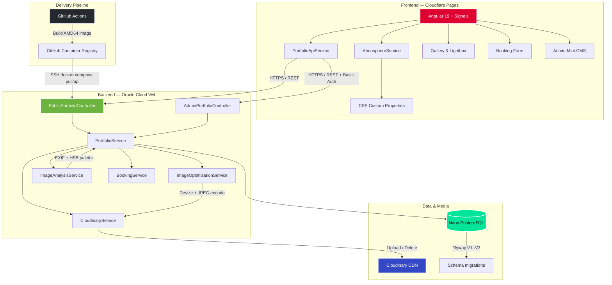

# 📸 Drawing With Light — Photography Portfolio & Event Booking Platform

> **A production photography platform with an adaptive atmosphere engine, EXIF telemetry overlays, server-side image optimization, and a custom Spring Boot mini-CMS.**

<div align="center">

**By Night / By Day** — Adaptive Photography Platform & Custom Mini-CMS

[](https://photos.riste-gjorgjiev.dev)
[](https://riste-gjorgjiev.dev)
[](https://openjdk.org/projects/jdk/21/)
[](https://spring.io/projects/spring-boot)
[](https://angular.io/)
[](https://neon.tech/)
[](https://pages.cloudflare.com/)
[](https://www.oracle.com/cloud/)

</div>

---

## 🌐 Live Deployment

| Service | URL / Platform |
| :--- | :--- |
| **Photography portfolio** | [photos.riste-gjorgjiev.dev](https://photos.riste-gjorgjiev.dev) |
| **Main portfolio** | [riste-gjorgjiev.dev](https://riste-gjorgjiev.dev) |
| **Frontend hosting** | Cloudflare Pages |
| **Backend API** | Oracle Cloud VM — `https://api.riste-gjorgjiev.dev/api/v1` |
| **Database** | Neon — managed PostgreSQL |
| **Image delivery** | Cloudinary CDN |
| **CI/CD** | GitHub Actions → GHCR → Oracle Cloud via SSH |

The photography site is a companion to the main portfolio at **[riste-gjorgjiev.dev](https://riste-gjorgjiev.dev)**.

---

## 🎯 Project Overview

This is a **production photography portfolio and event booking platform** built for two audiences:

1. **Event Promoters & Clients** — immediate visual impact, curated event albums, and a frictionless booking pipeline.
2. **Tech Recruiters & Engineering Managers** — full-stack delivery across Angular Signals, Spring Boot, PostgreSQL, media processing, cloud deployment, and CI/CD.

### Core Features

- 🌓 **Adaptive Atmosphere Engine** — toggle between `BY NIGHT` (obsidian canvas) and `BY DAY` (warm slate) with ambient color shifts driven by the image being viewed.
- 🎨 **Dynamic Color Extraction** — every uploaded photo's dominant palette is extracted server-side using saturation-weighted HSB sampling.
- 📷 **EXIF Telemetry HUD** — photo cards and the lightbox show camera body, lens, ISO, aperture, shutter speed, focal length, and capture date.
- 🖼️ **Zero-CLS Masonry Grid** — intrinsic dimensions from the server plus responsive 1/2/3-column layouts prevent layout shift on mobile and desktop.
- 📅 **Event Booking Pipeline** — reactive form with date validation, budget range, duration, event type, and custom project details.
- 🔐 **Admin Mini-CMS** — category, album, and photo management, drag-and-drop bulk uploads, booking status workflow, and confirmation-based deletes.
- ⚡ **Server-Side Upload Pipeline** — oversized photos are decoded with subsampling, resized, and re-encoded as JPEG before Cloudinary upload.
- 🔍 **Fullscreen Lightbox** — keyboard navigation, camera telemetry sidebar, and a Java 21 DTO JSON inspector tab.

---

## 🏗️ System Architecture



---

## ⚡ Key Engineering Highlights

### 🖼️ Server-Side Image Optimization

Cloudinary's free plan rejects assets above 10 MiB, while full-resolution event photos routinely exceed that limit. `ImageOptimizationService` solves this before upload:

- Reads dimensions from the image header without a full decode.
- Passes files through untouched when they already fit the configured limits.
- Decodes oversized images with `ImageReadParam.setSourceSubsampling(...)` to bound JVM heap usage on a small VM.
- Scales to a maximum dimension of **3200 px** and re-encodes as JPEG at **quality 0.9**.
- Progressively lowers quality and dimensions until the file is under the **9 MiB safety limit**.
- Extracts EXIF **before** optimization and persists it in PostgreSQL, since the re-encoded asset does not retain metadata.

### 📤 Resilient Bulk Uploads

The admin studio accepts drag-and-drop files and whole folders:

- Recursively walks dropped directories using the File System Access API.
- Uploads with **3 concurrent workers** instead of firing every request at once.
- Skips duplicate files by `name + size`, ignores non-images, and flags files over **25 MB**.
- Tracks pending, uploading, done, and failed states per file.
- Stops the queue on authentication failure and reports per-file errors from RFC 7807 responses.
- Batches successful additions into the photo grid to avoid repeated full re-renders.

### 🎯 Zero-CLS Responsive Gallery

- `NgOptimizedImage` uses intrinsic `width`/`height` extracted by the server.
- CSS `columns-*` masonry with `break-inside: avoid` prevents card splitting.
- Mobile layout switches cleanly between 1, 2, and 3 balanced columns.
- `@defer (on viewport)` keeps offscreen photo cards from blocking initial render.

### 🎨 GPU-Accelerated Ambient Backdrop

- Ambient glow uses `filter: blur(120px)` and `transform: translateZ(0)`.
- CSS custom properties (`--ambient-primary`, `--ambient-secondary`) morph smoothly between photos.
- Opacity stays capped so photo colors remain accurate.
- Hovering a photo, opening the lightbox, or switching Day/Night updates the atmosphere through Signals.

### 🔬 Metadata & Palette Extraction

- `metadata-extractor` reads camera make/model, lens, focal length, aperture, shutter speed, ISO, and capture date.
- Pixel dimensions come from the image stream header without decoding the full file.
- Color analysis decodes at **≤1024 px** and samples a **24×24 grid**, avoiding the memory cost of a 40 MP decode.
- Dual-zone (top/bottom half) saturation-weighted averaging produces two ambient hex colors.
- Missing EXIF or unreadable images fall back gracefully to category defaults.

### 🔄 Reactive Signal State

- Angular 19 Signals (`signal()`, `computed()`, `effect()`) replace RxJS `BehaviorSubject` state.
- `AtmosphereService` owns lighting mode, active category/album, ambient colors, and EXIF HUD state.
- `AuthService` exposes computed authentication state and the Basic Auth header.
- `inject()` and standalone components throughout; no `NgModule`.

### 📡 Standardized Error Handling

- `GlobalExceptionHandler` returns RFC 7807 `ProblemDetail` responses.
- Dedicated exceptions for **404** (`ResourceNotFoundException`), **409** (`ConflictException`), and upstream storage failures (`ExternalServiceException`).
- Validation, conflict, not-found, and external-service errors all follow the same JSON contract.
- The frontend surfaces `detail`/`title` messages and logs technical details to the console.

### 🔐 Hardened Stateless Security

- Admin endpoints use stateless HTTP Basic Auth.
- CORS includes localhost, the apex domain, `www`, and a wildcard subdomain pattern for `*.riste-gjorgjiev.dev`.
- Additional origins can be supplied through `CORS_ALLOWED_ORIGINS`.
- Actuator health is public; every other non-public route is denied.
- CSRF is disabled for the stateless API; no server-side sessions are created.

---

## 🚀 Local Quickstart

### Prerequisites

- **Java 21** (Temurin recommended)
- **Maven 3.9+**
- **Node.js 20+** and npm
- **Docker** (for local PostgreSQL)

> The repository does not include a Maven wrapper, so use `mvn` rather than `./mvnw`.

### 1. Start PostgreSQL

```bash
docker compose up -d postgres
```

PostgreSQL 16 runs on `localhost:5433`, mapped from container port `5432`.

**Local credentials:**

- Database: `photography_portfolio`
- User: `portfolio_user`
- Password: `portfolio_secret`

### 2. Start the Backend

```bash
cd backend

# Optional: override local defaults
cat > .env <<EOF
ADMIN_USERNAME=admin
ADMIN_PASSWORD=admin123
CLOUDINARY_CLOUD_NAME=your-cloud-name
CLOUDINARY_API_KEY=your-api-key
CLOUDINARY_API_SECRET=your-api-secret
EOF

mvn spring-boot:run
```

The API runs on `http://localhost:8080`.

**Default admin credentials:** `admin` / `admin123`

Without real Cloudinary credentials (`CLOUDINARY_CLOUD_NAME=demo`), uploads fall back to base64 data URIs so local development still works.

### 3. Start the Frontend

```bash
cd frontend
npm install
npm start
```

The app runs on `http://localhost:4200` and calls `http://localhost:8080/api/v1`.

### 4. Access the Application

| Page | URL |
| :--- | :--- |
| **Home** | [http://localhost:4200/](http://localhost:4200/) |
| **Explore gallery** | [http://localhost:4200/explore](http://localhost:4200/explore) |
| **Book Me** | [http://localhost:4200/booking](http://localhost:4200/booking) |
| **Admin login** | [http://localhost:4200/admin](http://localhost:4200/admin) |
| **Admin studio** | [http://localhost:4200/admin/dashboard](http://localhost:4200/admin/dashboard) |

On a fresh database the portfolio is empty by design: sign in to the admin studio and create your first category, then album, then upload photos.

---

## 🧪 Testing

### Backend

```bash
cd backend
mvn test
```

The suite covers:

- `CorsConfigurationTest` — built-in and configured production origins.
- `AdminPortfolioControllerTest` — category/album/photo endpoints and conflict responses.
- `PublicPortfolioControllerTest` — public filtering, booking validation, and errors.
- `GlobalExceptionHandlerTest` — RFC 7807 `ProblemDetail` responses.
- `CloudinaryServiceTest` — upload, fallback, and failure behavior.
- `ImageAnalysisServiceTest` — dimensions, hex validation, and fallbacks.
- `ImageOptimizationServiceTest` — oversized downscaling, pass-through, and unreadable input.

Tests use an H2 in-memory database and the `demo` Cloudinary mode, so no external services are required.

### Frontend

```bash
cd frontend
npm run build
```

`ng build` defaults to the production configuration. It replaces `environment.ts` with `environment.prod.ts`, enables output hashing, and writes to `dist/frontend/browser`.

---

## 🌐 Production Deployment

### Deployment Topology

```text
Visitor
  │
  ├── https://photos.riste-gjorgjiev.dev
  │      └── Cloudflare Pages (Angular static assets)
  │
  └── https://api.riste-gjorgjiev.dev/api/v1
         └── Oracle Cloud VM (Spring Boot Docker container)
                ├── Neon PostgreSQL
                └── Cloudinary
```

### Frontend — Cloudflare Pages

| Setting | Value |
| :--- | :--- |
| Root directory | `frontend` |
| Build command | `npm ci && npm run build` |
| Build output directory | `dist/frontend/browser` |
| Node version | 20+ |
| Custom domain | `photos.riste-gjorgjiev.dev` |

SPA routing is handled by `frontend/wrangler.jsonc`:

```jsonc
{
  "name": "photography-portfolio",
  "compatibility_date": "2026-11-12",
  "assets": {
    "directory": "./dist/frontend/browser",
    "not_found_handling": "single-page-application"
  }
}
```

No `_redirects` file is required because Cloudflare Pages falls back to `index.html` through `not_found_handling`.

The production API URL is compiled from `frontend/src/environments/environment.prod.ts`:

```ts
export const environment = {
  production: true,
  apiUrl: 'https://api.riste-gjorgjiev.dev/api/v1',
};
```

### Backend — Oracle Cloud

The backend is packaged as an AMD64 Docker image and deployed to an Oracle Cloud VM.

**Pipeline:** `.github/workflows/deploy-backend.yml`

1. Triggered by pushes to `main`/`master` that touch `backend/**` or the workflow itself (also supports `workflow_dispatch`).
2. Builds the image from `backend/Dockerfile` for `linux/amd64`.
3. Pushes `ghcr.io/riste-gjorgjiev/photography-api:latest` to GitHub Container Registry.
4. Connects to the Oracle VM over SSH and runs:

```bash
cd ~/photography-api
docker compose -f docker-compose.prod.yml pull backend
docker compose -f docker-compose.prod.yml up -d
docker image prune -f
```

The production compose file lives on the VM at `~/photography-api/docker-compose.prod.yml` and is not committed to this repository.

**Required GitHub Actions secrets:**

- `ORACLE_HOST` — VM hostname or public IP.
- `ORACLE_SSH_KEY` — private SSH key for the `ubuntu` user.

`GITHUB_TOKEN` is provided automatically for GHCR authentication.

**Backend environment variables on the VM:**

| Variable | Purpose |
| :--- | :--- |
| `DB_URL` | Neon JDBC URL, e.g. `jdbc:postgresql://<host>/<db>?sslmode=require` |
| `DB_USERNAME` | Neon database user |
| `DB_PASSWORD` | Neon database password |
| `ADMIN_USERNAME` | Admin Basic Auth username |
| `ADMIN_PASSWORD` | Admin Basic Auth password |
| `CLOUDINARY_CLOUD_NAME` | Cloudinary cloud name |
| `CLOUDINARY_API_KEY` | Cloudinary API key |
| `CLOUDINARY_API_SECRET` | Cloudinary API secret |
| `CORS_ALLOWED_ORIGINS` | Extra comma-separated origins, if needed |
| `PORT` | Optional server port (default `8080`) |
| `UPLOAD_MAX_DIMENSION` | Optional resize cap (default `3200`) |
| `UPLOAD_JPEG_QUALITY` | Optional JPEG quality (default `0.9`) |
| `UPLOAD_MAX_BYTES` | Optional size cap (default `9437184`, ~9 MiB) |

### Database — Neon

Neon hosts the production PostgreSQL database. Spring Boot connects through the standard datasource variables above. Use Neon's pooled connection string and include `sslmode=require`.

Flyway runs on startup with `baseline-on-migrate: true` and applies:

- `V1__init_schema.sql` — tables, constraints, generated columns, and indexes.
- `V2__seed_sample_data.sql` — demo albums, photos, and categories.
- `V3__remove_seed_sample_data.sql` — clears the demo content so production starts empty.

The root `neon.ts` file configures Neon branch policy for CLI workflows: non-default branches auto-expire after 7 days.

### Images — Cloudinary

1. Create an account at [cloudinary.com](https://cloudinary.com/).
2. Copy the cloud name, API key, and API secret into the backend environment.
3. Uploads are stored under `portfolio/<category-slug>/<uuid>`.
4. The backend uses Cloudinary's chunked `uploadLarge()` API, then `destroy()` on photo deletion.

Oversized images are compressed locally before upload, so the free plan's 10 MiB per-asset cap is no longer a blocker.

### CORS

The backend always allows:

```text
http://localhost:4200
http://localhost
https://riste-gjorgjiev.dev
https://www.riste-gjorgjiev.dev
https://*.riste-gjorgjiev.dev
```

Add more origins with `CORS_ALLOWED_ORIGINS`. Credentials are enabled and preflight responses are cached for one hour.

### Optional — Self-Hosted Full Stack

The included `docker-compose.yml` runs the complete stack locally or on a single server:

```bash
docker compose up -d
```

- **PostgreSQL 16** — port `5433`
- **Spring Boot** — port `8080`, multi-stage JRE Alpine image
- **Angular + nginx** — port `80`, SPA fallback and `/api/` proxy to the backend

For the managed production setup above, only Cloudflare Pages, the Oracle API container, Neon, and Cloudinary are used.

> The shipped production environment points the Angular app at `https://api.riste-gjorgjiev.dev/api/v1`. If you self-host the Docker frontend against a different API host, update `frontend/src/environments/environment.prod.ts` before building.

---

## 📂 Project Structure

```text
photography-portfolio/
├── .github/workflows/
│   └── deploy-backend.yml        # Build AMD64 image → GHCR → Oracle Cloud deploy
├── docker-compose.yml            # Local PostgreSQL + backend + frontend
├── neon.ts                       # Neon CLI branch policy
├── package.json                  # Root Neon CLI dependencies
├── README.md
│
├── backend/
│   ├── pom.xml                   # Java 21, Spring Boot 3.4.2, Flyway, Cloudinary, metadata-extractor
│   ├── Dockerfile                # Multi-stage build (Maven/JDK 21 → JRE 21 Alpine)
│   ├── .env                      # Local secrets (gitignored)
│   └── src/
│       ├── main/
│       │   ├── java/com/portfolio/photography/
│       │   │   ├── config/       # SecurityConfig, CloudinaryConfig
│       │   │   ├── controller/   # PublicPortfolioController, AdminPortfolioController
│       │   │   ├── domain/       # JPA entities + enums
│       │   │   ├── dto/          # Java 21 records + PortfolioMapper
│       │   │   ├── exception/    # GlobalExceptionHandler, ResourceNotFound, Conflict, ExternalService
│       │   │   ├── repository/   # Spring Data JPA repositories
│       │   │   └── service/      # Portfolio, Booking, Cloudinary, ImageAnalysis, ImageOptimization
│       │   └── resources/
│       │       ├── application.yml
│       │       └── db/migration/ # Flyway V1–V3
│       └── test/                 # 7 test classes, H2 + demo Cloudinary
│
└── frontend/
    ├── package.json              # Angular 19, Tailwind CSS 3.4, lucide-angular
    ├── angular.json              # Production fileReplacements + budgets
    ├── Dockerfile                # Node build → nginx serve
    ├── nginx.conf                # SPA fallback + API proxy
    ├── wrangler.jsonc            # Cloudflare Pages config
    └── src/
        ├── environments/         # Dev + production API URLs
        ├── app/
        │   ├── core/
        │   │   ├── models/       # TypeScript interfaces matching Java DTOs
        │   │   └── services/     # AtmosphereService, PortfolioApiService, AuthService
        │   ├── shared/components/
        │   │   ├── ambient-backdrop/
        │   │   ├── navbar/
        │   │   ├── photo-card/
        │   │   ├── lightbox-modal/
        │   │   ├── tech-badge-footer/
        │   │   └── ui-icon/      # Lucide icon wrapper + providers
        │   └── features/
        │       ├── home/         # Panoramic hero + featured highlights
        │       ├── gallery/      # Event albums + masonry grid
        │       ├── booking/      # Reactive booking form
        │       └── admin/        # Login + CMS studio
        ├── public/               # robots.txt, sitemap.xml, favicon
        └── index.html            # SEO meta tags + Open Graph
```

> `PROJECT_BLUEPRINT.md` is a local planning document and is intentionally excluded from the published repository.

---

## 🛠️ Tech Stack

### Backend

- **Java 21** — records, pattern matching, virtual-thread-ready runtime.
- **Spring Boot 3.4.2** — Web, Data JPA, Validation, Security, Actuator.
- **Neon PostgreSQL** — managed production database with UUID primary keys, generated columns, and constrained relations.
- **PostgreSQL 16** — local Docker database matching the development schema.
- **Flyway** — versioned migrations (`V1` schema, `V2` seed, `V3` cleanup).
- **Cloudinary Java SDK 2.5** — chunked image upload/delete with local data-URI fallback.
- **metadata-extractor 2.21** — EXIF camera, lens, exposure, ISO, and capture date.
- **Java ImageIO** — subsampled decoding, bicubic resize, JPEG re-encoding.
- **Lombok** — constructor injection and entity boilerplate reduction.
- **JUnit 5 + Spring Boot Test + Mockito + AssertJ** — unit and MVC tests.
- **H2** — in-memory database for tests.

### Frontend

- **Angular 19** — standalone components, Signals, `@if`/`@for`, `inject()`.
- **TypeScript 5.7** — strict typing and DTO contracts.
- **Tailwind CSS 3.4** — dark editorial theme, responsive layouts.
- **NgOptimizedImage** — intrinsic sizing and responsive loading.
- **RxJS 7.8** — HTTP client with `provideHttpClient(withFetch())`.
- **Lucide Angular** — consistent icon system.

### DevOps & Hosting

- **Cloudflare Pages** — Angular static hosting and SPA fallback.
- **Oracle Cloud** — backend VM running Docker.
- **Neon** — managed PostgreSQL.
- **GitHub Actions** — backend image build and SSH deployment.
- **GitHub Container Registry** — private backend images.
- **Docker + Docker Compose** — local full stack and production backend runtime.
- **Maven** — backend build and tests.
- **npm / Angular CLI** — frontend build tooling.

---

## 📊 Database Schema

Four tables with UUID primary keys and a generated `aspect_ratio` column:

- **`categories`** — name, slug, description, `DAY`/`NIGHT`, default ambient hex, display order.
- **`event_albums`** — title, slug, parent category, venue, location, event date, cover image, accent hex, featured flag.
- **`photos`** — Cloudinary public ID, image URL, intrinsic dimensions, aspect ratio, time of day, category, optional album, two dominant hex colors, full EXIF metadata, featured flag, display order.
- **`booking_inquiries`** — client details, event details, date, duration, budget range, project brief, and status (`NEW → CONTACTED → BOOKED → ARCHIVED`).

The schema is created by Flyway. Demo content seeded in `V2` is removed by `V3`, so a fresh production database starts with no categories, albums, or photos.

---

## 🔌 REST API

### Public — `/api/v1/public`

| Method | Endpoint | Description |
| :--- | :--- | :--- |
| `GET` | `/categories?timeOfDay=NIGHT` | Categories, optionally filtered by light mode |
| `GET` | `/albums?timeOfDay=NIGHT&categorySlug=...` | Albums, optionally filtered |
| `GET` | `/albums/{slug}` | Single album by slug |
| `GET` | `/photos?timeOfDay=...&categorySlug=...&albumSlug=...&featuredOnly=true` | Photos with nested EXIF and palette |
| `POST` | `/bookings` | Create a booking inquiry (`201 Created`) |

### Admin — `/api/v1/admin`

All admin endpoints require HTTP Basic Auth.

| Method | Endpoint | Description |
| :--- | :--- | :--- |
| `POST` | `/photos` | Upload a photo (`multipart/form-data`: `file` + `request` JSON) |
| `DELETE` | `/photos/{id}` | Delete a photo and its Cloudinary asset |
| `POST` | `/albums` | Create an event album |
| `DELETE` | `/albums/{id}` | Delete an album |
| `POST` | `/categories` | Create a category (duplicate slug → `409 Conflict`) |
| `DELETE` | `/categories/{id}` | Delete an empty category (in-use category → `409 Conflict`) |
| `GET` | `/bookings` | List all booking inquiries |
| `PATCH` | `/bookings/{id}/status?status=BOOKED` | Update booking status |

Errors follow RFC 7807 `ProblemDetail` with `type`, `title`, `status`, `detail`, and `instance`.

---

## 🔒 Security

- **Public endpoints** (`/api/v1/public/**`) — no authentication.
- **Admin endpoints** (`/api/v1/admin/**`) — HTTP Basic Auth with credentials from environment variables.
- **Actuator health** (`/actuator/health`) — public for container health checks.
- **Everything else** — denied by default.
- **CORS** — explicit production origins plus wildcard subdomains under `riste-gjorgjiev.dev`.
- **CSRF** — disabled for the stateless API.
- **Sessions** — `STATELESS`; credentials are held only in the browser's in-memory auth service.
- **Secrets** — `.env` files are gitignored; production values live in the Oracle VM environment and GitHub Actions secrets.

---

## 📝 License

This project is open source and available under the MIT License.

---

## 🤝 Contributing

Contributions, issues, and feature requests are welcome.

1. Fork the project.
2. Create your feature branch (`git checkout -b feature/AmazingFeature`).
3. Commit your changes (`git commit -m 'Add some AmazingFeature'`).
4. Push to the branch (`git push origin feature/AmazingFeature`).
5. Open a Pull Request.

---

## 📧 Links

- **Photography portfolio:** [photos.riste-gjorgjiev.dev](https://photos.riste-gjorgjiev.dev)
- **Main portfolio:** [riste-gjorgjiev.dev](https://riste-gjorgjiev.dev)
- **Repository:** [github.com/riste-gjorgjiev/Photography-Portfolio](https://github.com/riste-gjorgjiev/Photography-Portfolio)

---

<div align="center">

**Built with ❤️ by a photographer who codes (and a coder who photographs)**

*Angular 19 · Java 21 · Spring Boot 3.4 · Neon PostgreSQL · Cloudinary · Oracle Cloud · Cloudflare Pages*

</div>
