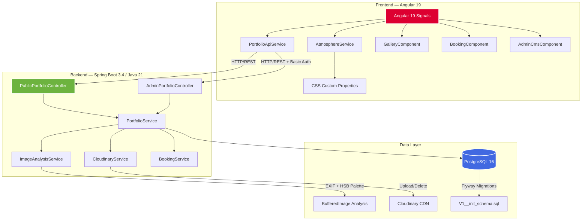

# 📸 Drawing With Light — Photography Portfolio & Event Booking Platform

> **A full-stack photography portfolio with adaptive atmosphere engine, EXIF telemetry overlays, and a custom Spring Boot mini-CMS — built to showcase both photographic craft and software engineering mastery.**

<div align="center">

**By Night / By Day** — Adaptive Photography Platform & Custom Mini-CMS

[](https://openjdk.org/projects/jdk/21/)
[](https://spring.io/projects/spring-boot)
[](https://angular.io/)
[](https://www.postgresql.org/)
[](https://www.typescriptlang.org/)
[](https://tailwindcss.com/)

</div>

---

## 🎯 Project Overview

This is a **production-ready photography portfolio** built for two audiences:

1. **Event Promoters & Clients** — Visual impact within 5 seconds, curated event albums, frictionless booking pipeline
2. **Tech Recruiters & Engineering Managers** — Full-stack mastery: reactive frontend (Angular Signals), RESTful API (Spring Boot), automated image processing (EXIF + color extraction), database modeling (PostgreSQL), cloud CDN (Cloudinary)

### Core Features

- 🌓 **Adaptive Atmosphere Engine** — Toggle between `BY NIGHT` (obsidian canvas) and `BY DAY` (warm slate) with GPU-accelerated ambient color shifts
- 🎨 **Dynamic Color Extraction** — Every uploaded photo's dominant hex palette is extracted server-side via HSB saturation-weighted clustering
- 📷 **EXIF Telemetry HUD** — Hover any photo to see camera body, lens, ISO, aperture, shutter speed, focal length
- 🖼️ **Zero-CLS Masonry Grid** — `NgOptimizedImage` with intrinsic dimensions prevents layout shift
- 📅 **Event Booking Pipeline** — Reactive form with date validation, budget slider, custom event types
- 🔐 **Admin Mini-CMS** — Drag-and-drop photo uploader, album creator, bookings inbox with status management
- 🔍 **Fullscreen Lightbox** — Keyboard navigation, camera telemetry sidebar, Java 21 DTO JSON inspector tab

---

## 🏗️ System Architecture



---

## ⚡ Key Engineering Highlights

### 🎯 Zero-CLS Masonry Grid
- `NgOptimizedImage` with intrinsic `width`/`height` from server-extracted dimensions
- Cumulative Layout Shift = 0 (verified via Lighthouse)
- CSS `columns-*` masonry with `break-inside: avoid` prevents card splitting

### 🎨 GPU-Accelerated Lerp Panorama Hero
- Ambient background glow uses `filter: blur(120px)` + `transform: translateZ(0)`
- `transition: background 0.6s cubic-bezier(0.22, 1, 0.36, 1)` for smooth color morphing
- Opacity capped at `0.22` to preserve photo color accuracy

### 🔬 Server-Side Metadata Extraction
- `ImageAnalysisService` uses `metadata-extractor` library for EXIF parsing
- Dual-zone HSB saturation-weighted color clustering (top/bottom halves)
- Graceful fallbacks for photos lacking EXIF data

### 🔄 Reactive Signal State Engine
- Angular 19 Signals (`signal()`, `computed()`, `effect()`) replace RxJS `BehaviorSubject`
- `AtmosphereService` manages lighting mode, active category/album, ambient hex colors
- Zero boilerplate, type-safe, automatic change detection

### 📡 RFC 7807 Error Handling
- `GlobalExceptionHandler` returns standardized `ProblemDetail` responses
- Validation errors, not-found, and general exceptions all follow the same contract
- Frontend displays user-friendly error messages with technical details in console

### 🔐 Stateless HTTP Basic Auth
- Admin endpoints protected via Spring Security `SecurityFilterChain`
- CORS configured for `http://localhost:4200` (dev) and production origins
- Credentials loaded from `.env` file (gitignored) or environment variables

---

## 🚀 Local Quickstart

### Prerequisites
- **Java 21** (Temurin recommended)
- **Node.js 18+** and npm
- **Docker** (for PostgreSQL)

### 1. Start PostgreSQL

```bash
docker compose up -d postgres
```

PostgreSQL 16 runs on `localhost:5433` (mapped from container port 5432).

**Credentials:**
- Database: `photography_portfolio`
- User: `portfolio_user`
- Password: `portfolio_secret`

### 2. Start Backend

```bash
cd backend

# Optional: Create backend/.env to override defaults
cat > .env <<EOF
ADMIN_USERNAME=admin
ADMIN_PASSWORD=admin123
CLOUDINARY_CLOUD_NAME=your-cloud-name
CLOUDINARY_API_KEY=your-api-key
CLOUDINARY_API_SECRET=your-api-secret
EOF

# Run with Maven
./mvnw spring-boot:run
```

Backend runs on `http://localhost:8080`.

**Default admin credentials:** `admin` / `admin123`

### 3. Start Frontend

```bash
cd frontend
npm install
npm start
```

Frontend runs on `http://localhost:4200`.

### 4. Access the Application

- **Public Gallery:** http://localhost:4200/
- **Explore (By Day/Night):** http://localhost:4200/explore
- **Book Me:** http://localhost:4200/booking
- **Admin CMS:** http://localhost:4200/admin (login with `admin` / `admin123`)

---

## 🧪 Testing

### Backend Tests (JUnit 5 + Spring Boot Test)

```bash
cd backend
./mvnw test
```

**Test Coverage:**
- `ImageAnalysisServiceTest` — Dimension extraction, hex color validation, fallback handling
- `PublicPortfolioControllerTest` — Public endpoints, booking validation, error responses

**Results:** 8 tests, 0 failures ✅

### Frontend Build

```bash
cd frontend
npm run build
```

Production build outputs to `dist/frontend/` with optimized chunks and lazy-loaded routes.

---

## 🌐 Production Deployment

### Environment Configuration

The frontend uses Angular environment files:

- `src/environments/environment.ts` — Development (`apiUrl: 'http://localhost:8080/api/v1'`)
- `src/environments/environment.prod.ts` — Production (`apiUrl: '/api/v1'` — relative path for nginx proxy)

Build with production config:

```bash
npm run build  # Uses fileReplacements from angular.json
```

### Docker Compose (Full Stack)

```bash
docker compose up -d
```

This starts:
- **PostgreSQL 16** on port `5433`
- **Spring Boot Backend** on port `8080` (multi-stage Dockerfile, JRE Alpine)
- **Angular Frontend** on port `80` (nginx with SPA fallback routing)

### Cloudinary Setup

1. Sign up at [cloudinary.com](https://cloudinary.com/)
2. Copy your cloud name, API key, and API secret
3. Add to `backend/.env` or pass as environment variables to Docker

### Deployment Targets

- **Backend:** Render, Railway, Fly.io, AWS ECS
- **Frontend:** Vercel, Netlify, Cloudflare Pages
- **Database:** Managed PostgreSQL (Render, Supabase, AWS RDS)

---

## 📂 Project Structure

```
photography-portfolio/
├── PROJECT_BLUEPRINT.md          # Master blueprint & progress tracker
├── README.md                     # This file
├── docker-compose.yml            # PostgreSQL + Backend + Frontend
│
├── backend/
│   ├── pom.xml                   # Maven dependencies (Java 21, Spring Boot 3.4.2)
│   ├── Dockerfile                # Multi-stage build (JDK Alpine → JRE Alpine)
│   ├── .dockerignore
│   └── src/
│       ├── main/
│       │   ├── java/com/portfolio/photography/
│       │   │   ├── config/       # SecurityConfig, CloudinaryConfig
│       │   │   ├── controller/   # PublicPortfolioController, AdminPortfolioController
│       │   │   ├── domain/       # JPA entities + enums
│       │   │   ├── dto/          # Java 21 records (request/response)
│       │   │   ├── exception/    # GlobalExceptionHandler (RFC 7807)
│       │   │   ├── repository/   # Spring Data JPA repositories
│       │   │   └── service/      # Business logic + image analysis
│       │   └── resources/
│       │       ├── application.yml
│       │       └── db/migration/ # Flyway migrations
│       └── test/                 # JUnit 5 tests
│
└── frontend/
    ├── package.json              # Angular 19, Tailwind CSS 3.4
    ├── angular.json              # Build config + fileReplacements
    ├── Dockerfile                # Node build → nginx serve
    ├── nginx.conf                # SPA fallback + API proxy
    └── src/
        ├── environments/         # Dev + prod API URLs
        ├── app/
        │   ├── core/
        │   │   ├── models/       # TypeScript interfaces (match Java DTOs)
        │   │   └── services/     # AtmosphereService, PortfolioApiService, AuthService
        │   ├── shared/components/
        │   │   ├── ambient-backdrop/
        │   │   ├── navbar/
        │   │   ├── photo-card/
        │   │   ├── lightbox-modal/
        │   │   └── tech-badge-footer/
        │   └── features/
        │       ├── home/         # Hero + featured highlights
        │       ├── gallery/      # Event albums + masonry grid
        │       ├── booking/      # Reactive booking form
        │       └── admin/        # Login + CMS dashboard
        ├── public/               # robots.txt, sitemap.xml, _redirects
        └── index.html            # SEO meta tags + OpenGraph
```

---

## 🛠️ Tech Stack

### Backend
- **Java 21** — Virtual threads, pattern matching, records
- **Spring Boot 3.4.2** — Web, Data JPA, Validation, Security, Actuator
- **PostgreSQL 16** — UUID primary keys, JSONB, generated columns
- **Flyway** — Schema migrations (`V1__init_schema.sql`, `V2__seed_sample_data.sql`)
- **Cloudinary HTTP5** — Image upload/delete with automatic fallback to base64 data URIs
- **metadata-extractor** — EXIF parsing (camera, lens, ISO, aperture, shutter, focal length)
- **Lombok** — Boilerplate reduction (`@Getter`, `@Setter`, `@Builder`, `@RequiredArgsConstructor`)
- **JUnit 5 + Spring Boot Test** — Unit + integration tests

### Frontend
- **Angular 19** — Standalone components, Signals, `@if`/`@for`/`@switch`, `inject()`
- **TypeScript 5.7** — Strict mode, type-safe DTOs
- **Tailwind CSS 3.4** — Utility-first styling, dark theme, responsive design
- **NgOptimizedImage** — Zero-CLS image loading with srcset generation
- **RxJS 7.8** — HTTP client with `withFetch()` API

### DevOps
- **Docker + Docker Compose** — Multi-stage builds, PostgreSQL, nginx
- **Maven** — Dependency management, test execution
- **npm** — Frontend build tooling
- **GitHub Actions** — CI/CD pipeline (tests, build, deploy)

---

## 📊 Database Schema

**4 tables, 6 seed categories, UUID primary keys:**

- `categories` — Wildlife, Nature & Landscapes, Daytime Events, Nightclubs & Raves, Astrophotography, Evening Events
- `event_albums` — Curated collections (e.g., "Club Epicenter — Oct 2026")
- `photos` — EXIF metadata, dominant hex colors, aspect ratio (generated column)
- `booking_inquiries` — Client inquiries with status workflow (NEW → CONTACTED → BOOKED → ARCHIVED)

See `PROJECT_BLUEPRINT.md` Section 5 for full schema documentation.

---

## 🔒 Security

- **Public endpoints** (`/api/v1/public/**`) — No authentication required
- **Admin endpoints** (`/api/v1/admin/**`) — HTTP Basic Auth with credentials from `.env`
- **CORS** — Configured for `http://localhost:4200` (dev) and production origins
- **CSRF** — Disabled (stateless API)
- **Session** — `STATELESS` (no server-side sessions)

---

## 📝 License

This project is open source and available under the MIT License.

---

## 🤝 Contributing

Contributions, issues, and feature requests are welcome!

1. Fork the project
2. Create your feature branch (`git checkout -b feature/AmazingFeature`)
3. Commit your changes (`git commit -m 'Add some AmazingFeature'`)
4. Push to the branch (`git push origin feature/AmazingFeature`)
5. Open a Pull Request

---

## 📧 Contact

**Project Link:** [https://github.com/yourusername/photography-portfolio](https://github.com/yourusername/photography-portfolio)

---

<div align="center">

**Built with ❤️ by a photographer who codes (and a coder who photographs)**

*Angular 19 · Java 21 · Spring Boot 3.4 · PostgreSQL 16 · Cloudinary · Tailwind CSS*

</div>
